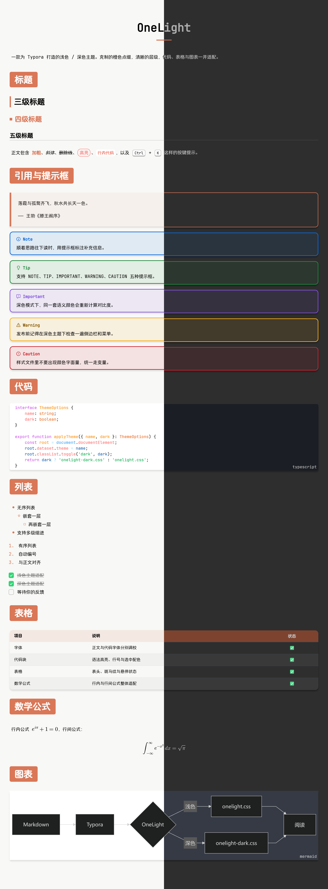

# OneLight

一个简洁、美观的主题



上面是一张长图：左半为浅色主题，右半为深色主题。

## 安装

在 [Releases](https://github.com/caolib/onelight/releases) 下载主题包之后，解压后将以下内容复制到 Typora 的主题目录（`%APPDATA%\Typora\themes`，或 Typora 偏好设置 → 外观 → 打开主题文件夹）：

- `onelight.css`
- `onelight-dark.css`
- `onelight/` 目录（字体等资源）

然后在 Typora 菜单 → 主题中启用 `OneLight` 或 `OneLight Dark`。

## 开发

源码是 SCSS，编译产物直接写到 Typora 主题目录。

```bash
pnpm install
pnpm build     # 一次性构建
pnpm build:min # 压缩产物（发布用）
pnpm watch     # 监听 src/，改动即重新编译
pnpm lint      # stylelint 检查（颜色字面量只允许出现在变量文件）
```

默认输出到 `%APPDATA%\Typora\themes`，可通过环境变量 `TYPORA_THEMES` 覆盖。

### 不重启 Typora 预览

Typora 不会自动重载主题。配合调试端口和 `dev/cdp.mjs`，改完立即看到效果：

```bash
node dev/cdp.mjs watch     # 构建产物变化时自动刷新 Typora 并截图到 dev/shot.png
node dev/cdp.mjs shot      # 刷新 + 截图
node dev/cdp.mjs dom "#write" 2
node dev/cdp.mjs hover "#write h2"
node dev/cdp.mjs eval "getComputedStyle(document.querySelector('#write h4')).backgroundColor"
```

前置条件见 [dev/README.md](dev/README.md)。

## 结构

```
src/
  onelight.scss          浅色入口
  onelight-dark.scss     深色入口（先 @use onelight，再覆盖）
  abstracts/
    _variables.scss      浅色 CSS 变量
    _variables-dark.scss 深色 CSS 变量
  style/                 各分类样式（title、code、table、list、blockquote…）
scripts/build.mjs        构建脚本（dart-sass）
dev/cdp.mjs              基于 CDP 的预览/调试工具
docs/demo.md             预览用示例文档
docs/showcase.md         README 预览图的源文档
docs/images/preview.png  README 预览图（左浅色右深色）
onelight/fonts/          资源字体
```

## License

MIT
