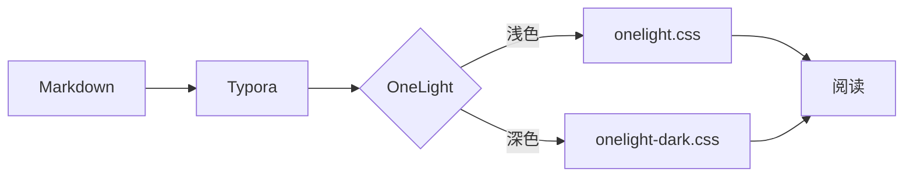

# OneLight

一款为 Typora 打造的浅色 / 深色主题。克制的橙色点缀，清晰的层级，代码、表格与图表一并适配。

## 标题

### 三级标题

#### 四级标题

##### 五级标题

正文包含 **加粗**、*斜体*、~~删除线~~、==高亮==、`行内代码`，以及 <kbd>Ctrl</kbd> + <kbd>K</kbd> 这样的按键提示。

## 引用与提示框

> 落霞与孤鹜齐飞，秋水共长天一色。
>
> —— 王勃《滕王阁序》

> [!NOTE]
> 顺着思路往下读时，用提示框标注补充信息。

> [!TIP]
> 支持 NOTE、TIP、IMPORTANT、WARNING、CAUTION 五种提示框。

> [!IMPORTANT]
> 深色模式下，同一套语义颜色会重新计算对比度。

> [!WARNING]
> 发布前记得在深色主题下检查一遍侧边栏和菜单。

> [!CAUTION]
> 样式文件里不要出现颜色字面量，统一走变量。

## 代码

```typescript
interface ThemeOptions {
    name: string;
    dark: boolean;
}

export function applyTheme({ name, dark }: ThemeOptions) {
    const root = document.documentElement;
    root.dataset.theme = name;
    root.classList.toggle('dark', dark);
    return dark ? 'onelight-dark.css' : 'onelight.css';
}
```

## 列表

- 无序列表
    - 嵌套一层
        - 再嵌套一层
- 支持多级缩进

1. 有序列表
2. 自动编号
3. 与正文对齐

- [x] 浅色主题适配
- [x] 深色主题适配
- [ ] 等待你的反馈

## 表格

| 项目     | 说明                       | 状态 |
| :------- | :------------------------- | :--: |
| 字体     | 正文与代码字体分别调校     |  ✅  |
| 代码块   | 语法高亮、行号与选中配色   |  ✅  |
| 表格     | 表头、斑马纹与悬停状态     |  ✅  |
| 数学公式 | 行内与行间公式整体适配     |  ✅  |

## 数学公式

行内公式 $e^{i\pi} + 1 = 0$，行间公式：

$$
\int_{-\infty}^{\infty} e^{-x^2} \, dx = \sqrt{\pi}
$$

## 图表


